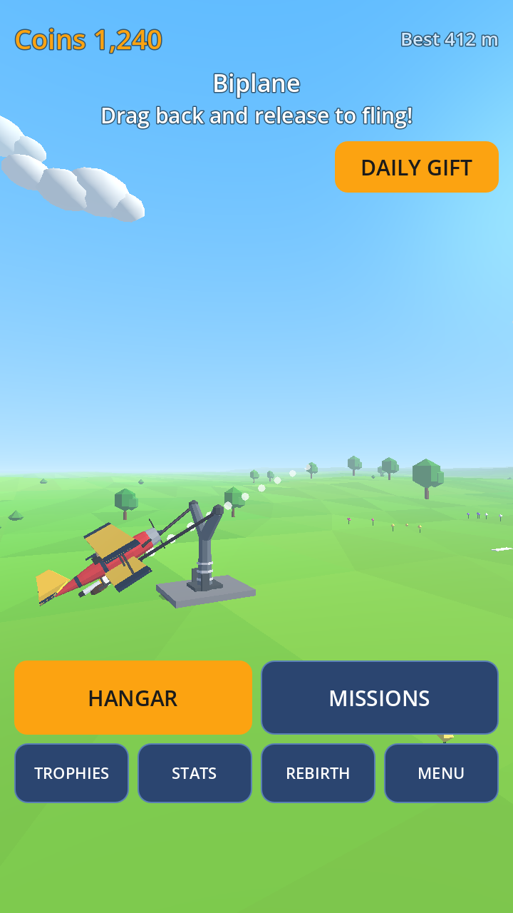
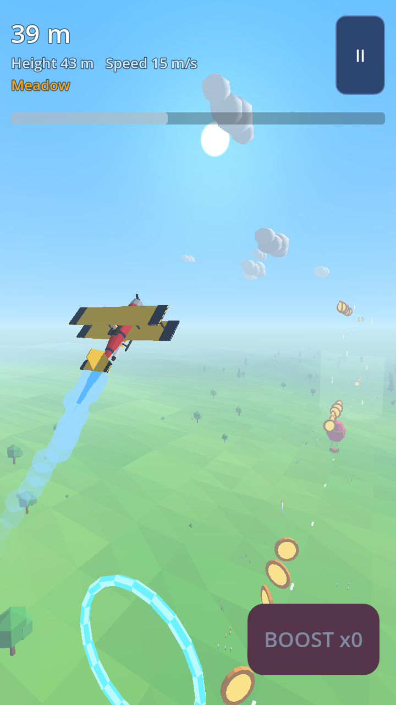
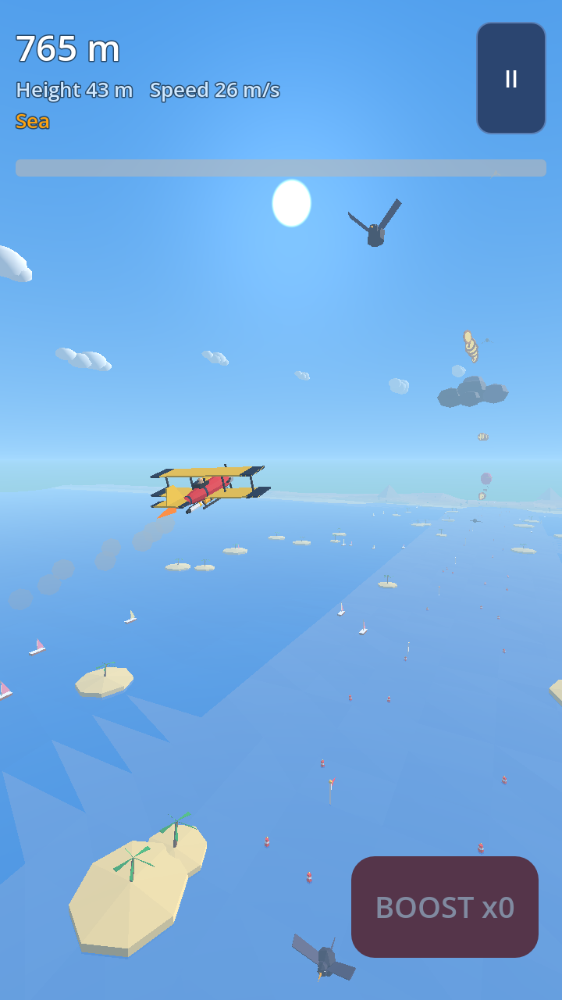
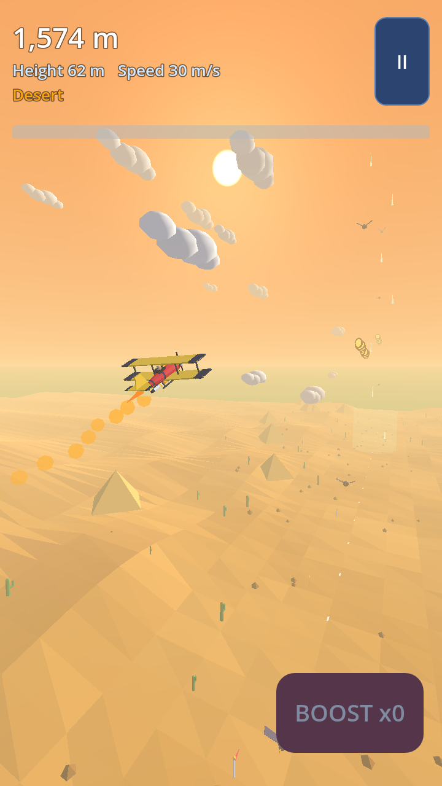
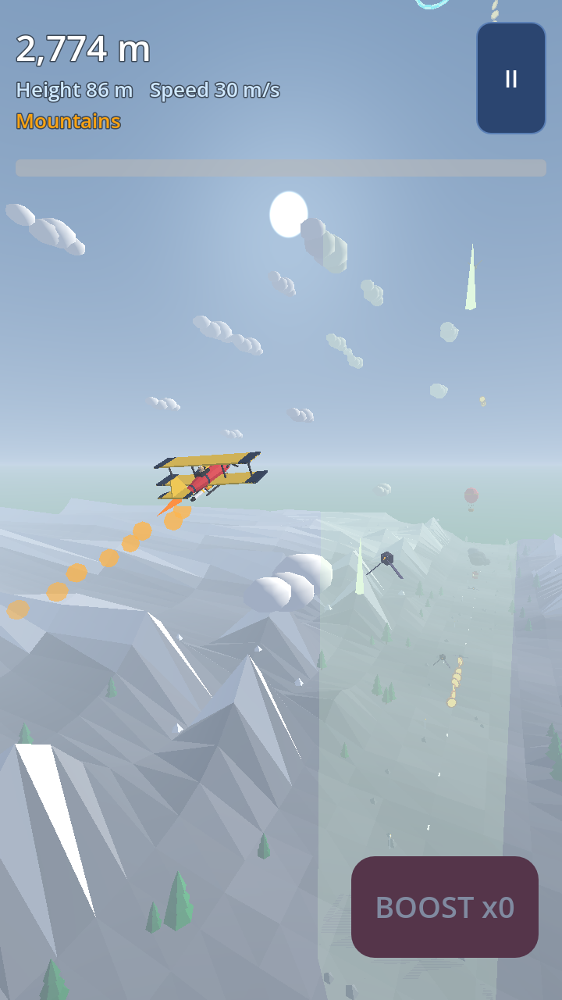
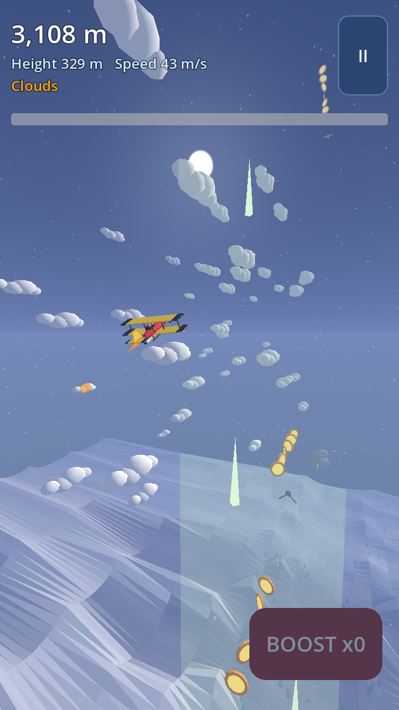
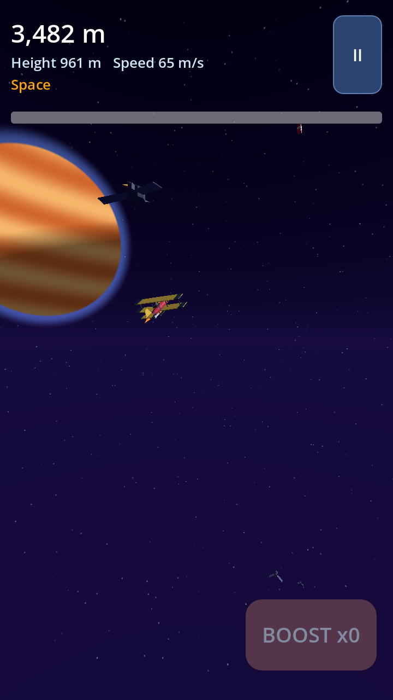
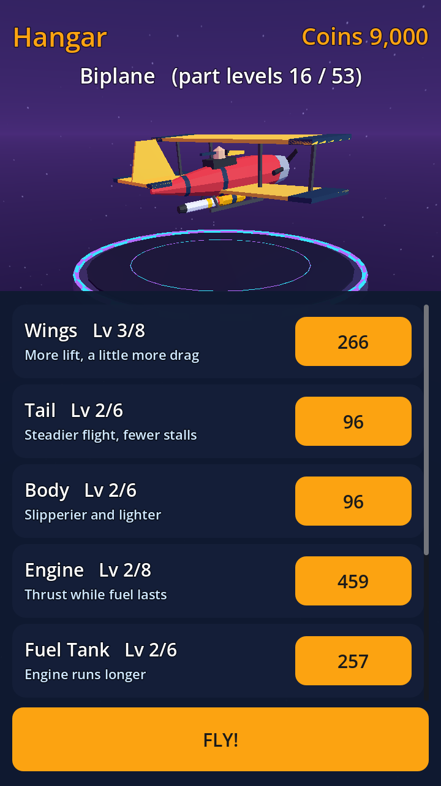
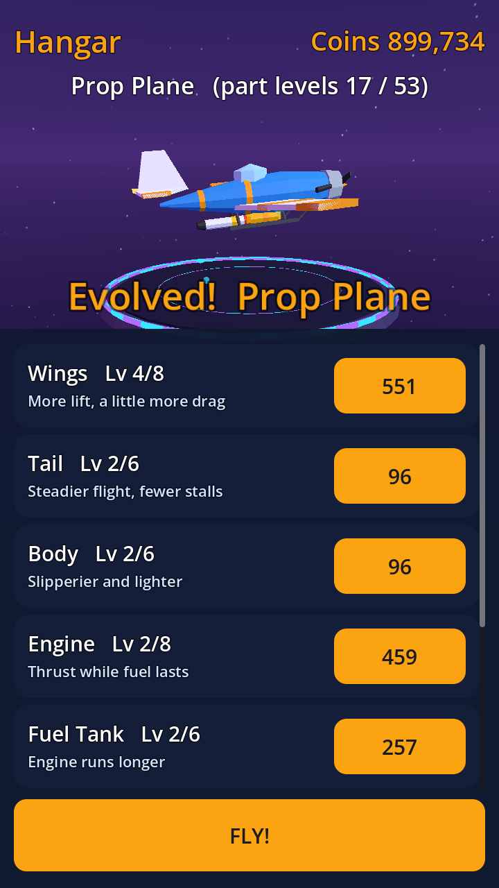

# Sky Fling

Fling a paper plane from a slingshot, grab coins, bolt on better parts and evolve it all the way to a Space Plane.
Reach Space, rebirth for Stars, and go even farther. A portrait mobile game made with Godot 4 (GDScript).
No ads, no in-app purchases, no third-party assets: all art and sound are generated in code.

   
    

## 3D (v2)
The game is rendered in real 3D (Godot Mobile renderer, 2x MSAA, no shadows, one cheap blob shadow). Every model is built in code from
primitive meshes (`scripts/game/mesh_builder.gd`): the plane (7 tier silhouettes, every part level looks different), the slingshot
(9 levels, stretching bands, 3D aim arc), pickups and hazards, and procedural terrain chunks per zone (pooled and freed as you fly,
so memory stays flat). Chase camera, landing camera, rotating hangar turntable. Flight physics is still the 2D vertical-plane model,
so balance is unchanged. The 2D HUD and menus overlay the 3D view.

## Controls
| Action | Touch | Keyboard / mouse |
|---|---|---|
| Aim and launch | Drag back from the slingshot, release | Mouse drag, release |
| Nose up / down | Hold right half / left half of the screen | Right, D, Up, W / Left, A |
| Boost rocket | BOOST button | Space |
| Pause / back | Pause button, Android back | Esc |

## Features
- Physics flight (gravity, drag, lift by angle of attack, stalls, fuel, boost charges), fixed 60 Hz step, seeded worlds.
- 8 upgradable parts (wings, tail, body, engine, fuel tank, booster, slingshot, skids), 5-8 levels each with geometric prices; each level changes the plane's look.
- 7 plane tiers: Paper plane, Balsa glider, Biplane, Prop plane, Jet, Rocket plane, Space plane, with an "Evolved!" celebration.
- 8 sky zones (Meadow, Hills, Sea, Desert, Mountains, Clouds, Upper Air, Space); Space has low gravity and thin air.
- Pickups and hazards: coins and coin lines, fuel cans, boost rings, updrafts, balloons, birds, storm clouds.
- 3 rolling missions, 34 trophies, daily reward with streak, best-flights page, records.
- Rebirth after reaching Space (600 m height): Stars buy permanent perks (coin boost, spare fuel, cheaper parts, head start).
- Versioned autosave in `user://`, corrupt saves start fresh, reset option with confirmation. Generated SFX with a mute toggle.

## Install the Android APK
`tools/build_apk.sh` builds `build/SkyFling.apk` (arm64-v8a, debug-signed). Copy it to the phone and open it
(allow "install unknown apps"), or `adb install build/SkyFling.apk`.
Needs Godot 4.7.2 with export templates, JDK 17 and the Android SDK (paths at the top of the script).

## Web build
`godot --headless --path . --export-release Web build/web/index.html` (single-threaded; any static host works).

## Develop
- Rules and balance live in `scripts/core/*` (pure scripts, headless-testable); UI in `scripts/game/*`.
- **One test command:** `tools/run_tests.sh` (unit, upgrades-matter, 10,000-flight NaN stress, balance simulation,
  UI smoke with real input events, layout at 720x1280 and 1080x2400, plus negative tests that sabotage the code and must be caught).
- `tools/shots.sh` captures the screenshots under Xvfb.

## License
MIT
